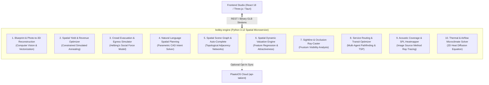

# Bobby Spatial Intelligence Engine: Strategic Architecture & Roadmap

> **System**: Bobby CAD & `bobby-engine` (Python 3.12 / FastAPI Computational Geometry Microservice)  
> **Philosophy**: Cross-Functional, Lowkey & Seamless Intelligence (<50MB RAM, Sub-Second Execution)  
> **Deployment**: 100% Offline-First & Independent, with Optional Opt-In Sync to PlaatoOS / Takient

---

## 🏛️ Executive Summary & Design Principles

This roadmap outlines the planned evolution of **`bobby-engine`** from an authoritative collision-checking microservice into a comprehensive **Spatial Intelligence & Computational Geometry Engine**.

The architecture adheres to four core design tenets:
1. **Seamless & Lowkey Integration**: The intelligence operates quietly in the background. Rather than forcing users into separate complex tools, the engine continuously verifies constraints, surfaces non-intrusive warnings, and offers one-click optimizations directly within the CAD flow.
2. **Cross-Purpose Utility**: Each capability bridges multiple disciplines simultaneously—combining **life-safety compliance (egress codes)**, **commercial yield (seating revenue)**, and **CAD productivity (automated vectorization)** into unified mathematical representations.
3. **Pure Algorithmic Python**: Heavy computation delegates to C-accelerated scientific libraries (`numpy`, `scipy`, `shapely`, `trimesh`, `opencv-python-headless`). No bloated multi-gigabyte models or heavyweight GPU requirements; runs cleanly in **under 50MB RAM** on local machines or free cloud tiers.
4. **Complete Standalone Isolation**: The entire stack operates 100% offline with zero proprietary cloud lock-in. Integration with enterprise platforms like PlaatoOS / Takient is strictly opt-in.

---

## 📋 The 10 Seamless Spatial Capabilities

---

### 1. Blueprint & Photo to 3D CAD Reconstruction
*Domain: Computer Vision, Topological Vectorization & Photogrammetry*

#### Cross-Purpose Impact
Eliminates manual drafting friction. Venue operators take a smartphone photo of a framed fire-exit map, upload a PDF blueprint, or drop a sketched PNG. The system silently converts noisy raster pixels into clean, metric 3D CAD walls with window and door cutouts.

#### Algorithmic Approach
- **Image Conditioning**: Adaptive Gaussian binarization and bilateral filtering to remove paper folds and shadows.
- **Centerline Thinning**: Morphological skeletonization reducing thick strokes to 1-pixel skeletons.
- **Probabilistic Hough Line Transform**:
  $$\rho = x \cos \theta + y \sin \theta$$
- **Collinear Clustering & Junction Snapping**:
  Merges collinear lines within threshold $\epsilon_d$ and snaps endpoints to form watertight 2-manifold polygons.
- **Aperture Detection**:
  Template matching and contour classification detecting radial arcs ($90^\circ$ door swings) and parallel window marks.

#### Production Specs
- **Module**: `services/bobby-engine/src/ai/vision.py`
- **Dependencies**: `opencv-python-headless`, `numpy`, `scipy.ndimage`, `shapely`.
- **Endpoint**: `POST /v1/ai/reconstruct-blueprint` $\to$ returns verified `WallSegment[]` and compiled GLB.

---

### 2. Spatial Yield & Revenue Optimizer
*Domain: Constrained Combinatorial Optimization & Metaheuristics*

#### Cross-Purpose Impact
Simultaneously satisfies two opposing goals: **maximizing venue revenue/capacity** while **strictly enforcing fire safety egress corridors ($\ge 1.2\text{m}$)**. Venue owners gain thousands in event revenue without risking code violations.

#### Algorithmic Approach
- **Non-Convex Constrained Spatial Packing**:
  $$\max_{\Theta} \quad \mathcal{J}(\Theta) = w_r \mathcal{R}(\Theta) + w_c \mathcal{C}(\Theta) + w_s \mathcal{S}(\Theta) - \sum_{k} \lambda_k \mathcal{P}_k(\Theta)$$
  - $\mathcal{R}(\Theta)$: Nightly revenue from table categories (`VIP`, `BOOTH`, `STANDARD`) and minimum spend rates.
  - $\mathcal{C}(\Theta)$: Total seating capacity normalized against room volume.
  - $\mathcal{S}(\Theta)$: Sightline vector alignment to the focal target (stage/DJ booth).
  - $\mathcal{P}_k(\Theta)$: Quadratic penalty barriers $\max(0, 1.2\text{m} - \text{dist}(\text{OBB}_i, \text{Corridor}))^2$ preventing collisions and aisle bottlenecks.
- **Solver**: **Adaptive Simulated Annealing (ASA)** with temperature cooling $T_{k+1} = \alpha T_k$ ($\alpha = 0.98$) and spatial perturbation operators (translation jitter, $15^\circ$ rotation snaps, category swaps).

#### Production Specs
- **Module**: `services/bobby-engine/src/ai/yield_optimizer.py`
- **Dependencies**: `numpy`, `scipy.optimize`, `shapely`.
- **Endpoint**: `POST /v1/ai/optimize-layout` $\to$ returns reconfigured `VenueLayout` + audit metrics.

---

### 3. Agent-Based Crowd Evacuation & Egress Simulator
*Domain: Agent-Based Modeling (ABM) & Continuous Physics Simulation*

#### Cross-Purpose Impact
Provides empirical life-safety verification. Rather than guessing if a dense VIP layout can evacuate safely during an emergency, the engine runs continuous multi-agent physics to verify escape times and spot crush bottlenecks.

#### Algorithmic Approach
- **Helbing's Continuous Social Force Model**:
  $$m_i \frac{d\vec{v}_i}{dt} = \vec{f}_i^0 + \sum_{j \ne i} \vec{f}_{ij} + \sum_{w} \vec{f}_{iw}$$
  - $\vec{f}_i^0$: Desired velocity vector toward nearest exit derived from a 2D Euclidean Distance Field (EDF).
  - $\vec{f}_{ij}$: Psychological repulsive force and physical compression between neighboring agents:
    $$\vec{f}_{ij} = A_i \exp\left(\frac{r_{ij} - d_{ij}}{B_i}\right) \vec{n}_{ij} + k \cdot g(r_{ij} - d_{ij}) \vec{n}_{ij}$$
  - $\vec{f}_{iw}$: Obstacle repulsion from wall polylines and furniture bounding boxes.
- **Telemetry**: Evacuation time curve $N_{\text{escaped}}(t)$, egress bottleneck density heatmap ($\text{agents}/m^2$), and NFPA/IBC compliance score.

#### Production Specs
- **Module**: `services/bobby-engine/src/ai/evacuation.py`
- **Dependencies**: `numpy`, `scipy.spatial.KDTree`, `shapely`.
- **Endpoint**: `POST /v1/ai/simulate-evacuation` $\to$ returns time-series trajectory keyframes and density grid.

---

### 4. Natural Language Spatial Planning Agent
*Domain: Structured Spatial Reasoning & Parametric Intent Solving*

#### Cross-Purpose Impact
Allows non-technical event planners to execute complex CAD operations with simple English prompts (*"Set up a 120-person gala with a stage on the north wall and 10 VIP tables with 1.5m aisles"*), lowering the barrier to entry for 3D layout design.

#### Algorithmic Approach
- **Structured Semantic Parsing**: Extracts spatial entities, geometric anchors, numerical constraints, and category distributions into strict Pydantic schemas.
- **Geometric Constraint Solver**: Binds entities relative to room boundaries and visual anchors.
- **Self-Correcting Verification Loop**: Passes preliminary coordinates through `SpatialCollisionEngine`; if interferences or egress issues are detected, residual error vectors programmatically adjust object coordinates before finalizing.

#### Production Specs
- **Module**: `services/bobby-engine/src/ai/agent_planner.py`
- **Dependencies**: `pydantic`, `bobby-engine.geometry`.
- **Endpoint**: `POST /v1/ai/generate-from-prompt` $\to$ returns authoritative `VenueLayout`.

---

### 5. Spatial Scene Graph & Layout Auto-Completion
*Domain: Graph Theory, Relational Learning & Network Topology*

#### Cross-Purpose Impact
Acts as a silent co-pilot during CAD editing. When an operator places a VIP sofa, the engine automatically suggests matching side tables, service aisles, and partition dividers in optimal relative alignment.

#### Algorithmic Approach
- **Attributed Spatial Graph (ASG)**:
  $$\mathcal{G} = (\mathcal{V}, \mathcal{E}, \mathcal{A}_v, \mathcal{A}_e)$$
  - Nodes $\mathcal{V}$: Scene objects with 3D poses and categories.
  - Edges $\mathcal{E}$: Adjacency, line-of-sight visibility, and functional dependencies.
  - Betweenness Centrality $C_B(v)$: Highlights pedestrian thoroughfares and isolated clusters.
- **Motif Auto-Completion**: Identifies incomplete topological patterns and predicts coordinate placement for complementary items.

#### Production Specs
- **Module**: `services/bobby-engine/src/ai/scene_graph.py`
- **Dependencies**: `networkx`, `scipy.spatial`.
- **Endpoint**: `POST /v1/ai/scene-graph/analyze` & `/auto-complete`.

---

### 6. Spatial Dynamic Valuation Engine
*Domain: Spatial Feature Engineering & Machine Learning*

#### Cross-Purpose Impact
Bridges spatial geometry with commercial ticketing. Instead of flat table pricing, the engine evaluates 3D spatial properties (sightlines, noise, privacy) to recommend optimal booking prices and minimum spends.

#### Algorithmic Approach
- **8D Spatial Feature Vector $\mathbf{x}_i$**:
  - Distance to stage/DJ booth $d_{\text{stage}}$
  - Unoccluded ray visibility percentage $\text{VisRatio}$
  - Distance to main bar $d_{\text{bar}}$
  - Proximity penalty to restrooms and kitchens
  - Privacy index (distance to nearest neighboring table)
  - Clearance width of adjacent access paths
- **Lightweight Valuation Model**: Predicts optimal table `basePrice` using gradient-boosted decision trees (`scikit-learn` / `xgboost`).

#### Production Specs
- **Module**: `services/bobby-engine/src/ai/valuation.py`
- **Dependencies**: `scikit-learn`, `numpy`, `scipy`.
- **Endpoint**: `POST /v1/ai/predict-pricing` $\to$ returns table valuation matrix and pricing recommendations.

---

### 7. VIP Sightline & Visibility Ray-Caster
*Domain: Computational Geometry & 3D Frustum Occlusion*

#### Cross-Purpose Impact
Prevents costly customer disputes. VIP guests paying premium bottle-service prices demand clear views. The engine casts 3D sightline cones to guarantee zero visual occlusion from columns, high-backed seating, or bar fixtures.

#### Algorithmic Approach
- **Möller–Trumbore Ray-Triangle Intersection**:
  - Casts conical bundles of $K$ rays from seated observer eye-level ($Y = 1.2\text{m}$) toward target focal extents.
  - Intersects rays against all 3D scene meshes:
    $$\vec{R}(t) = \vec{O} + t \vec{D}, \quad t \in [0, \|\vec{T} - \vec{O}\|]$$
  - Visibility Quality Score:
    $$V_i = \frac{1}{K} \sum_{k=1}^{K} \mathbb{I}(\text{Ray}_k \text{ unoccluded})$$
- Generates a panoramic visibility matrix and a customer POV camera preview.

#### Production Specs
- **Module**: `services/bobby-engine/src/ai/sightline.py`
- **Dependencies**: `trimesh.ray`, `numpy`.
- **Endpoint**: `POST /v1/ai/sightline-analysis` $\to$ returns visibility scores and occlusion maps.

---

### 8. Waitstaff Service Routing Optimizer
*Domain: Multi-Agent Pathfinding (MAPF) & Operations Research*

#### Cross-Purpose Impact
Improves operational efficiency. Inefficient furniture placement causes waiter traffic jams and slow drink delivery. The engine evaluates service circulation paths to minimize staff transit times between bars and tables.

#### Algorithmic Approach
- **NavMesh Discretization**: 2D grid representation with inflated obstacle clearance buffers.
- **A* Pathfinding**: Computes all-pairs shortest paths between kitchen/bar pick-up zones and seating areas.
- **Vehicle Routing Problem (VRP) Heuristic**: Evaluates typical multi-table service rounds to calculate average transit times and flag high-friction bottleneck corridors.

#### Production Specs
- **Module**: `services/bobby-engine/src/ai/routing.py`
- **Dependencies**: `networkx`, `scipy.spatial`.
- **Endpoint**: `POST /v1/ai/service-efficiency` $\to$ returns transit metrics and corridor traffic heatmaps.

---

### 9. Acoustic Coverage & SPL Heatmapper
*Domain: Geometric Wave Acoustics & Ray-Tracing*

#### Cross-Purpose Impact
Prevents acoustic dead zones and sound complaints. Validates that audio from DJ stacks or presentation speakers reaches all seats clearly without exceeding legal decibel thresholds or deafening adjacent VIP booths.

#### Algorithmic Approach
- **Image Source Method (ISM)**:
  $$L_p(r) = L_w - 20 \log_{10}(r) - 11 + \sum_{\text{reflections}} 10 \log_{10}(1 - \alpha_{\text{surface}})$$
  - Accounts for direct sound and specular reflections up to 2nd order.
  - Uses surface absorption coefficients $\alpha \in [0, 1]$ (glass = 0.05, wood = 0.15, acoustic drapery = 0.60).
- Generates a continuous 2D decibel heatmap projected onto the floorplan.

#### Production Specs
- **Module**: `services/bobby-engine/src/ai/acoustics.py`
- **Dependencies**: `numpy`, `scipy.ndimage`.
- **Endpoint**: `POST /v1/ai/acoustic-heatmap` $\to$ returns decibel distribution grid.

---

### 10. Thermal & Airflow Microclimate Solver
*Domain: Physics-Informed Numerical Simulation & Heat Transfer*

#### Cross-Purpose Impact
Protects guest comfort. Crowded dance floors rapidly overheat, while perimeter tables suffer cold drafts from entrance doors. The engine computes 2D temperature distributions to inform HVAC and portable cooling placement.

#### Algorithmic Approach
- **2D Steady-State Heat Diffusion**:
  $$\frac{\partial^2 T}{\partial x^2} + \frac{\partial^2 T}{\partial z^2} = -\frac{Q(x, z)}{k}$$
  - $Q(x, z)$: Body heat generation ($\sim 100\text{W}$ per occupant), lighting rigs, and equipment.
  - Boundary conditions: AC output registers ($18^\circ\text{C}$) and exterior entrance draft thresholds.
- Solved via finite-difference relaxation matrix operations in NumPy.

#### Production Specs
- **Module**: `services/bobby-engine/src/ai/thermal.py`
- **Dependencies**: `scipy.sparse`, `numpy`.
- **Endpoint**: `POST /v1/ai/thermal-comfort` $\to$ returns temperature distribution grid.

---

## 📊 Comparative Technical Matrix

| Capability | Algorithmic Rigor | Key Scientific Libraries | Memory Footprint | Visual Feedback in 3D | Practical Value |
| :--- | :---: | :--- | :---: | :---: | :---: |
| **1. Blueprint-to-3D Vision** | ★★★★★ | `opencv`, `scipy.ndimage` | < 30 MB | 3D Watertight Extruded Walls | Rapid onboarding from photos |
| **2. Spatial Yield Optimizer** | ★★★★★ | `numpy`, `scipy.optimize` | < 15 MB | Auto-arranged 3D layout | Maximized revenue & safe egress |
| **3. Crowd Evacuation Sim** | ★★★★★ | `numpy`, `scipy.spatial` | < 25 MB | Animated fleeing agents & heatmaps | Municipal life-safety verification |
| **4. Natural Language Agent** | ★★★★☆ | `pydantic`, spatial solver | < 20 MB | Prompt-to-3D scene update | Conversational venue design |
| **5. Scene Graph Auto-Complete**| ★★★★☆ | `networkx`, `scipy` | < 15 MB | Contextual snapping & clusters | 5x faster CAD drafting |
| **6. Dynamic Pricing ML** | ★★★★☆ | `scikit-learn`, `numpy` | < 20 MB | Color-coded pricing heatmap | Optimized table minimum spends |
| **7. VIP Sightline Ray-Caster** | ★★★★☆ | `trimesh.ray`, `numpy` | < 15 MB | 3D sightline cones & POV preview | Blind-spot elimination |
| **8. Service Routing Optimizer** | ★★★★☆ | `networkx`, `scipy.spatial`| < 15 MB | High-traffic corridor highlights | Faster food & drink turnaround |
| **9. Acoustic SPL Heatmapper** | ★★★★☆ | `numpy`, `scipy.ndimage` | < 20 MB | 2D Decibel floor heatmap | Noise ordinance compliance |
| **10. Thermal Comfort Solver** | ★★★★☆ | `scipy.sparse`, `numpy` | < 20 MB | 2D Temperature floor heatmap | Climate & airflow planning |

---

## 🎯 Phased Implementation Sequence

### Phase 1: Foundational CAD Ingestion & Yield (High Synergy)
1. **Capability 1 (Blueprint & Photo-to-3D Reconstruction)**:
   - Eliminates drafting friction by turning any 2D photo or blueprint into clean 3D walls.
2. **Capability 2 (Spatial Yield & Revenue Optimizer)**:
   - Solves non-convex table packing, balances revenue and safety, and provides one-click layout optimization.

### Phase 2: Spatial Physics & Validation
3. **Capability 3 (Crowd Evacuation Simulator)**:
   - Continuous multi-agent life-safety verification with bottleneck heatmaps.
4. **Capability 7 (VIP Sightline Ray-Caster)**:
   - High-precision visibility matrices and guest POV previews.

### Phase 3: Workflow Intelligence & Topology
5. **Capability 4 (Natural Language Spatial Planner)**:
   - Parametric intent extraction and conversational layout modifications.
6. **Capability 5 (Spatial Scene Graphs)**:
   - Contextual auto-completion and topological room scoring.

---

## 🔒 Architectural Isolation Guarantee

1. **Self-Contained & Offline**: All 10 capabilities execute entirely within `services/bobby-engine` on `http://localhost:8000` or inside its Docker container. Zero mandatory external cloud dependencies.
2. **Minimal Resource Overhead**: Designed for <50MB RAM footprint, suitable for local development or free cloud tiers.
3. **PlaatoOS Cloud Sync Is Strictly Opt-In**: The studio functions completely standalone; cloud syncing only occurs when the user explicitly triggers synchronization.
