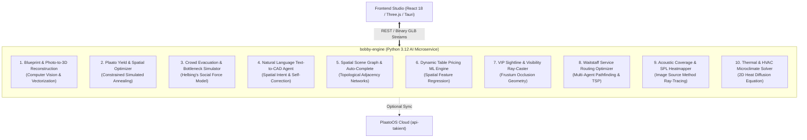

# Bobby AI: Master of Science in Artificial Intelligence — Strategic Roadmap & Future Plan

> **Author**: Graduate Master of AI Candidate (Focus: Applied Python, Computational Geometry & Spatial Intelligence)  
> **Repository**: [bobby (GitHub)](https://github.com/luisenriquecgongora/bobby)  
> **Core Architecture**: Standalone 3D CAD Web/Desktop Studio + Python 3.12 / FastAPI Computational Geometry Microservice (`bobby-engine`)  
> **Operating Guarantee**: 100% Offline-First, Zero External Proprietary Dependencies, Fully Isolated, with Optional Enterprise Synchronization to PlaatoOS / Takient.

---

## 🏛️ Executive Summary & Academic Purpose

This document establishes the strategic, algorithmic, and engineering roadmap for the expansion of **`bobby-engine`** into an enterprise-grade, academic portfolio capstone.

The objective is to demonstrate **advanced computational intelligence, mathematical rigor, and production Python engineering** across four foundational AI domains:
1. **Combinatorial Optimization & Operations Research** (Constrained Spatial Packing, Simulated Annealing, Multi-Objective Pareto Optimization).
2. **Computer Vision & Geometric Reconstruction** (Blueprint & Photogrammetric 2D-to-3D Vector Extraction).
3. **Agent-Based Modeling & Physics-Informed Simulation** (Continuous Social Force Crowd Evacuation).
4. **Discrete Mathematics & Graph Intelligence** (Spatial Scene Graphs, Visibility Ray-Casting & Pathfinding).

Crucially, every proposed module is designed to be **ultra-compact (<50MB RAM, zero multi-gigabyte bloat)**, runs natively in Python 3.12 with standard scientific libraries (`numpy`, `scipy`, `shapely`, `trimesh`, `opencv-python-headless`), and operates completely offline while providing direct, high-value utility to commercial venue platforms like PlaatoOS.

---

## 📋 The 10 Master of AI Proposals

---

### Proposal 1: Architectural Blueprint & Photo to 3D CAD Reconstruction
*Domain: Computer Vision, Image Processing & Vector Geometry*

#### The Problem
Venue managers typically possess physical architectural blueprints, PDF fire escape plans, or quick smartphone photos of room sketches. Manually measuring and drawing 2D polylines and placing window/door openings in CAD tools takes hours of tedious drafting.

#### Mathematical & Algorithmic Formulation
1. **Preprocessing & Binarization**:
   - Adaptive Gaussian thresholding and bilateral filtering to eliminate paper wrinkles and uneven lighting.
2. **Edge & Centerline Extraction**:
   - Morphological thinning (skeletonization) to reduce thick drafted walls to 1-pixel centerlines.
   - **Probabilistic Hough Line Transform**:
     $$\rho = x \cos \theta + y \sin \theta$$
   - Segment clustering using pairwise angular and collinear Euclidean distance thresholds:
     $$d_{\text{collinear}}(L_1, L_2) < \epsilon_d \quad \land \quad |\theta_1 - \theta_2| < \epsilon_\theta$$
3. **Symbol & Aperture Detection**:
   - Sliding-window contour aspect-ratio classification and template matching to identify radial arc door swings ($90^\circ$ circular arcs) and parallel double-line window indicators.
4. **Topology Assembly**:
   - Graph cycle detection (`networkx`) to find closed loops representing the outer room perimeter and interior partition walls.

#### Python Implementation Architecture
- **Module**: `services/bobby-engine/src/ai/vision.py`
- **Dependencies**: `opencv-python-headless`, `numpy`, `scipy.ndimage`, `shapely`.
- **Endpoint**: `POST /v1/ai/reconstruct-blueprint`
  - Input: Multipart form data with blueprint image (PNG, JPG) + optional room scale calibration (e.g. "North wall is 15 meters").
  - Output: `ExtrudeWallsResponse` containing verified `WallSegment[]` with embedded door/window apertures.

#### PlaatoOS & Business Value
Enables instant onboarding for new venue clients: take a picture of the fire escape plan on the wall $\to$ within 2 seconds, PlaatoOS has an interactive 3D virtual twin ready for table bookings.

---

### Proposal 2: Plaato Yield & Revenue Spatial Optimizer
*Domain: Constrained Combinatorial Optimization & Metaheuristics*

#### The Problem
Commercial venues lose 15–30% of potential revenue due to suboptimal furniture layouts. Manual table placement fails to find the global optimum balancing high-margin VIP tables, guest comfort, and mandatory municipal emergency egress corridors ($\ge 1.2\text{m}$).

#### Mathematical & Algorithmic Formulation
- Formulated as a **Non-Convex Constrained Spatial Packing Problem**:
  $$\max_{\Theta} \quad \mathcal{J}(\Theta) = w_r \mathcal{R}(\Theta) + w_c \mathcal{C}(\Theta) + w_s \mathcal{S}(\Theta) - \sum_{k} \lambda_k \mathcal{P}_k(\Theta)$$
  - **Revenue Term $\mathcal{R}(\Theta)$**:
    $$\mathcal{R}(\Theta) = \sum_{i \in \text{Tables}} \text{BasePrice}_i \times \text{TierMultiplier}_i$$
  - **Capacity Term $\mathcal{C}(\Theta)$**: Total seated guest count normalized against maximum structural floor capacity.
  - **Sightline Term $\mathcal{S}(\Theta)$**: Vector dot-product orientation towards the focal attraction (stage or DJ booth).
  - **Penalty Barrier $\mathcal{P}_k(\Theta)$**:
    $$\mathcal{P}_{\text{overlap}} = \sum_{i < j} \text{Area}(\text{OBB}_i \cap \text{OBB}_j)^2$$
    $$\mathcal{P}_{\text{egress}} = \sum_{i} \max\left(0, 1.2\text{m} - \text{dist}(\text{OBB}_i, \text{Corridor})\right)^2$$
- **Solver**: **Adaptive Simulated Annealing (ASA)** with Metropolis acceptance criterion:
  $$P(\Delta \mathcal{J}, T) = \exp\left(-\frac{\max(0, -\Delta \mathcal{J})}{T_k}\right), \quad T_{k+1} = \alpha T_k \quad (\alpha = 0.98)$$
  Spatial perturbation operators: Gaussian jitter translation, discrete $15^\circ$ rotation snaps, and category mutation (Standard $\leftrightarrow$ VIP Booth).

#### Python Implementation Architecture
- **Module**: `services/bobby-engine/src/ai/yield_optimizer.py`
- **Dependencies**: `numpy`, `scipy.optimize`, `shapely`.
- **Endpoint**: `POST /v1/ai/optimize-layout`
  - Input: Current `VenueLayout` + optimization weights (`revenue_weight`, `safety_weight`, `target_capacity`).
  - Output: Re-arranged `VenueLayout` + Audit report (`revenue_gain_percent`, `clearance_safety_index`).

#### PlaatoOS & Business Value
Directly increases PlaatoOS venue client revenue per square meter, eliminating layout guesswork and providing immediate ROI to event operators.

---

### Proposal 3: Agent-Based Crowd Evacuation & Bottleneck Simulator
*Domain: Agent-Based Modeling (ABM) & Continuous Physics AI*

#### The Problem
Municipal fire departments, insurance underwriters, and venue licensors mandate empirical verification that a venue layout can be evacuated within safety limits (e.g. under 90 seconds) without lethal crowd crush.

#### Mathematical & Algorithmic Formulation
- **Helbing's Social Force Model**:
  $$m_i \frac{d\vec{v}_i}{dt} = \vec{f}_i^0 + \sum_{j \ne i} \vec{f}_{ij} + \sum_{w} \vec{f}_{iw}$$
  1. **Self-Driven Desire Force**:
     $$\vec{f}_i^0 = m_i \frac{v_i^0 \vec{e}_i(t) - \vec{v}_i(t)}{\tau}$$
     where $\vec{e}_i(t)$ is the unit vector pointing toward the nearest accessible emergency exit computed via 2D Euclidean Distance Field (EDF).
  2. **Inter-Agent Repulsion & Compression**:
     $$\vec{f}_{ij} = A_i \exp\left(\frac{r_{ij} - d_{ij}}{B_i}\right) \vec{n}_{ij} + k \cdot g(r_{ij} - d_{ij}) \vec{n}_{ij} + \kappa \cdot g(r_{ij} - d_{ij}) \Delta v_{ji}^t \vec{t}_{ij}$$
  3. **Obstacle Repulsion**:
     Calculates repulsive forces from furniture and wall polygon boundaries using vector projection.
- **Metric Extraction**:
  - Evacuation Curve: Count of evacuated agents over time $N_{\text{escaped}}(t)$.
  - Bottleneck Density Heatmap: Peak spatial pressure $\text{agents}/m^2$ over a discretized spatial grid.

#### Python Implementation Architecture
- **Module**: `services/bobby-engine/src/ai/evacuation.py`
- **Dependencies**: `numpy`, `scipy.spatial.KDTree`, `shapely`.
- **Endpoint**: `POST /v1/ai/simulate-evacuation`
  - Input: `VenueLayout` + `occupant_count` (e.g. 250) + `simulation_duration_seconds`.
  - Output: Trajectory keyframes (time-series positions) + density bottleneck heatmap grid + NFPA compliance score.

#### PlaatoOS & Business Value
Permits automated compliance certification for venue licenses. Enables venue owners to prove that high-density VIP layouts are 100% life-safety compliant.

---

### Proposal 4: Natural Language "Text-to-Venue" Spatial Planning Agent
*Domain: LLM Spatial Reasoning, Structured Planning & Reflection*

#### The Problem
Non-technical event organizers (corporate party planners, wedding couples) cannot operate 3D CAD interfaces. They communicate specifications in conversational human language.

#### Mathematical & Algorithmic Formulation
1. **Semantic Constraint Extraction**:
   - Uses zero-shot structured output extraction to parse natural language into an **Intermediate Representation (IR)**:
     - Room functional type: Banquet, Cocktail Gala, Nightclub, Conference.
     - Entity counts and spatial relations: `{"entity": "stage", "wall_anchor": "NORTH"}`, `{"entity": "vip_booths", "quantity": 8, "focal_alignment": "stage"}`.
2. **Spatial Constraint Graph Generation**:
   - Maps relations into geometric inequalities:
     $$x_{\text{booth}} \in [x_{\min}, x_{\max}], \quad \theta_{\text{booth}} = \arctan\left(\frac{y_{\text{stage}} - y_{\text{booth}}}{x_{\text{stage}} - x_{\text{booth}}}\right)$$
3. **Execution & Self-Correction Reflection Loop**:
   - The agent invokes `SpatialCollisionEngine` to validate generated coordinates.
   - If collisions or clearance violations are detected, the residual error vector is fed back into the solver for programmatic coordinate adjustment.

#### Python Implementation Architecture
- **Module**: `services/bobby-engine/src/ai/agent_planner.py`
- **Dependencies**: `pydantic`, `instructor` / local function-calling parser, `bobby-engine.geometry`.
- **Endpoint**: `POST /v1/ai/generate-from-prompt`
  - Input: Text prompt string (e.g. *"Set up a corporate dinner for 120 guests with a dance floor in the middle"*).
  - Output: Complete authoritative `VenueLayout` JSON.

#### PlaatoOS & Business Value
Enables conversational event booking on PlaatoOS public tenant websites: prospective clients can type their dream setup and instantly tour it in 3D.

---

### Proposal 5: Spatial Scene Graph & Intelligent Layout Auto-Completion
*Domain: Graph Theory, Relational Learning & Network Topology*

#### The Problem
Placing individual 3D objects manually is fragmented. Designers want contextual intelligence: placing a table should automatically propose optimal chair offsets, service cart pathways, and power access lines.

#### Mathematical & Algorithmic Formulation
- **Attributed Spatial Graph (ASG)** representation:
  $$\mathcal{G} = (\mathcal{V}, \mathcal{E}, \mathcal{A}_v, \mathcal{A}_e)$$
  - **Vertices $\mathcal{V}$**: Venue objects (tables, bars, stages, doors, pillars).
  - **Vertex Attributes $\mathcal{A}_v$**: Spatial 3D pose $(x, y, z, \theta)$, bounding extents, functional category.
  - **Edges $\mathcal{E}$**: Physical adjacency, line-of-sight visibility, shared service alleys.
  - **Graph Centrality**:
    $$C_B(v) = \sum_{s \ne v \ne t} \frac{\sigma_{st}(v)}{\sigma_{st}}$$
    Calculates which tables are isolated or situated in main pedestrian traffic flows.
- **Auto-Completion Engine**:
  - Subgraph pattern matching identifies incomplete functional motifs (e.g. a VIP table missing dedicated service access or side credenza) and predicts coordinate placement for complementary elements.

#### Python Implementation Architecture
- **Module**: `services/bobby-engine/src/ai/scene_graph.py`
- **Dependencies**: `networkx`, `scipy.spatial`.
- **Endpoint**: `POST /v1/ai/scene-graph/analyze` and `POST /v1/ai/scene-graph/auto-complete`

#### PlaatoOS & Business Value
Turns Bobby into a CAD co-pilot that speeds up layout drafting by 5x through intelligent topological autocompletion.

---

### Proposal 6: Dynamic Pricing & Seat Attractiveness Predictor
*Domain: Spatial Feature Engineering & Supervised Machine Learning*

#### The Problem
Venues struggle with table pricing. Arbitrary pricing leads to unsold low-tier tables or underpriced prime VIP booths.

#### Mathematical & Algorithmic Formulation
1. **Spatial Feature Extraction**:
   For every table $i$, compute a continuous 8-dimensional spatial feature vector $\mathbf{x}_i$:
   - $d_{\text{stage}}$: Euclidean distance to focal center.
   - $\text{VisRatio}$: Unobstructed ray visibility percentage ($0.0 \to 1.0$).
   - $d_{\text{bar}}$: Proximity to beverage stations.
   - $d_{\text{restroom}}$: Proximity penalty to restrooms/kitchens.
   - $\text{Privacy}$: Distance to nearest neighboring guest table.
   - $\text{CorridorBuffer}$: Clearance width of adjacent access paths.
2. **Predictive Valuation Model**:
   $$\hat{y}_i = \mathbf{w}^T \mathbf{x}_i + b \quad \text{or gradient-boosted decision trees (LightGBM)}$$
   Trained on historical reservation minimum spends to output the expected optimal market price $\hat{P}_i$.

#### Python Implementation Architecture
- **Module**: `services/bobby-engine/src/ai/valuation.py`
- **Dependencies**: `scikit-learn`, `numpy`, `scipy`.
- **Endpoint**: `POST /v1/ai/predict-pricing`

#### PlaatoOS & Business Value
Direct algorithmic pricing engine for PlaatoOS ticketing and VIP table booking: dynamically maximizes event gross merchandise value (GMV).

---

### Proposal 7: VIP Sightline & Visibility Analysis Engine
*Domain: Computational Geometry, 3D Ray-Casting & Frustum Occlusion*

#### The Problem
High-paying VIP customers demand unblocked views of headline DJs or performers. Tall bars, structural pillars, or stage rigging frequently obstruct seated sightlines without the designer realizing it.

#### Mathematical & Algorithmic Formulation
- **3D Ray-Triangle Intersection (Möller–Trumbore Algorithm)**:
  - From observer seated eye position $O = (x_i, 1.2\text{m}, z_i)$, cast a conical bundle of $K$ rays toward target bounding box vertices $T_j$.
  - Intersect each ray with all scene bounding geometry (furniture, columns, walls):
    $$\vec{R}(t) = \vec{O} + t \vec{D}, \quad t \in [0, \|\vec{T} - \vec{O}\|]$$
  - Visibility Quality Index:
    $$V_i = \frac{1}{K} \sum_{k=1}^{K} \mathbb{I}(\text{Ray}_k \text{ unoccluded})$$
- Generates a panoramic visibility matrix and detects blind spots across the room.

#### Python Implementation Architecture
- **Module**: `services/bobby-engine/src/ai/sightline.py`
- **Dependencies**: `trimesh.ray.ray_pyembree` / pure NumPy vector ray-box intersection.
- **Endpoint**: `POST /v1/ai/sightline-analysis`

#### PlaatoOS & Business Value
Allows PlaatoOS to offer a "Guest POV 3D Preview" when customers purchase VIP tickets online, reducing refund disputes and increasing buyer confidence.

---

### Proposal 8: Waitstaff Service Routing & Transit Optimization
*Domain: Multi-Agent Pathfinding (MAPF) & Operations Research*

#### The Problem
Slow drink delivery directly reduces alcohol sales. Inefficient table arrangements create server traffic jams, dropped trays, and delayed orders.

#### Mathematical & Algorithmic Formulation
1. **Navigation Grid Extraction**:
   - 2D grid discretization with inflated obstacle buffers:
     $$\mathcal{M}(x, z) = \begin{cases} 0 & \text{if occupied by fixture or wall} \\ 1 & \text{if navigable floor} \end{cases}$$
2. **A* Pathfinding & Distance Matrix Computation**:
   - Computes all-pairs shortest paths between service bars, kitchens, and tables:
     $$D(u, v) = \text{A\_Star\_Distance}(u, v)$$
3. **Traveling Salesperson / Vehicle Routing (TSP/VRP)**:
   - Evaluates typical service rounds (delivering orders to multiple tables in one run) to calculate average transit times:
     $$\min \sum_{e \in E} c_e x_e$$

#### Python Implementation Architecture
- **Module**: `services/bobby-engine/src/ai/routing.py`
- **Dependencies**: `scipy.spatial`, `networkx`.
- **Endpoint**: `POST /v1/ai/service-efficiency`

#### PlaatoOS & Business Value
Empowers venue operations managers to test and optimize service turnaround times before reconfiguring their floor plan.

---

### Proposal 9: Acoustic Coverage & Sound Pressure Level (SPL) Heatmapper
*Domain: Geometric Acoustics & Wave Physics AI*

#### The Problem
Nightclubs and live music venues face two acoustic hazards: deafening sound pressure levels (>105 dB) directly adjacent to loudspeaker stacks that cause customer discomfort, and "acoustic dead zones" where audio is muffled by walls and partitions.

#### Mathematical & Algorithmic Formulation
- **Image Source Method (ISM) & Inverse Square Law**:
  $$L_p(r) = L_w - 20 \log_{10}(r) - 11 + \sum_{\text{reflections}} 10 \log_{10}(1 - \alpha_{\text{surface}})$$
  - Computes direct sound pressure level plus 1st and 2nd order wall specular reflections.
  - Accounts for material absorption coefficients $\alpha \in [0, 1]$ (glass = 0.05, wood = 0.15, curtain/acoustic drape = 0.60).
- Generates a continuous 2D Decibel Heatmap across the venue floor.

#### Python Implementation Architecture
- **Module**: `services/bobby-engine/src/ai/acoustics.py`
- **Dependencies**: `numpy`, `scipy.ndimage`.
- **Endpoint**: `POST /v1/ai/acoustic-heatmap`

#### PlaatoOS & Business Value
Enables audio engineering validation for music venues and prevents guest noise complaints or city sound ordinance fines.

---

### Proposal 10: Thermal & HVAC Comfort Microclimate Solver
*Domain: Physics-Informed Numerical Simulation & Heat Transfer*

#### The Problem
High-occupancy venues experience extreme heat accumulation around dense dance floors, while dining tables near entrance doors suffer from cold drafts.

#### Mathematical & Algorithmic Formulation
- **2D Steady-State Heat Diffusion Equation**:
  $$\nabla \cdot (k \nabla T) + Q = 0 \implies \frac{\partial^2 T}{\partial x^2} + \frac{\partial^2 T}{\partial z^2} = -\frac{Q(x, z)}{k}$$
  - **Heat Sources $Q$**: Seated/standing occupants generating body heat ($\sim 100\text{W}$ per person), lighting rigs, bar refrigeration equipment.
  - **Boundary Conditions**: Dirichlet conditions at AC vents ($T = 18^\circ\text{C}$) and doors ($T = T_{\text{outside}}$).
- Solved via discretized finite-difference relaxation matrix operations in NumPy.

#### Python Implementation Architecture
- **Module**: `services/bobby-engine/src/ai/thermal.py`
- **Dependencies**: `scipy.sparse`, `numpy`.
- **Endpoint**: `POST /v1/ai/thermal-comfort`

#### PlaatoOS & Business Value
Assists hospitality planners in optimizing guest comfort and sizing portable AC/heating units for event bookings.

---

## 📊 Comparative Evaluation Matrix

| Proposal | Academic AI Rigor | Python Algorithmic Depth | Memory Footprint | Visual 3D Impact | PlaatoOS Commercial Value | Implementation Complexity |
| :--- | :---: | :---: | :---: | :---: | :---: | :---: |
| **1. Blueprint-to-3D Vision** | ★★★★★ | ★★★★★ | < 30 MB | ★★★★★ | ★★★★★ | Medium (1–2 weeks) |
| **2. Plaato Yield Optimizer** | ★★★★★ | ★★★★★ | < 15 MB | ★★★★☆ | ★★★★★ | Medium (1 week) |
| **3. Crowd Evacuation Sim** | ★★★★★ | ★★★★★ | < 25 MB | ★★★★★ | ★★★★☆ | Medium (1–2 weeks) |
| **4. Text-to-CAD Agent** | ★★★★☆ | ★★★★☆ | < 20 MB | ★★★★☆ | ★★★★★ | Low–Med (1 week) |
| **5. Scene Graph Auto-Complete**| ★★★★☆ | ★★★★☆ | < 15 MB | ★★★☆☆ | ★★★★☆ | Medium (1 week) |
| **6. Dynamic Pricing ML** | ★★★★☆ | ★★★★☆ | < 20 MB | ★★★★☆ | ★★★★★ | Low (3–5 days) |
| **7. VIP Sightline Ray-Caster** | ★★★★☆ | ★★★★☆ | < 15 MB | ★★★★★ | ★★★★★ | Low–Med (4–6 days) |
| **8. Service Routing Optimizer** | ★★★★☆ | ★★★★☆ | < 15 MB | ★★★☆☆ | ★★★☆☆ | Medium (1 week) |
| **9. Acoustic SPL Heatmapper** | ★★★★☆ | ★★★★★ | < 20 MB | ★★★★☆ | ★★★☆☆ | Medium (1 week) |
| **10. Thermal HVAC Solver** | ★★★★☆ | ★★★★☆ | < 20 MB | ★★★☆☆ | ★★☆☆☆ | Low–Med (4–5 days) |

---

## 🎯 Recommended 3-Phase Master's Implementation Sequence

### Phase 1: Foundational AI Core (Immediate High-Impact Pairing)
1. **Proposal 1: Blueprint & Photo-to-3D Vision Pipeline**:
   - Enables users to upload any 2D floorplan or photo and get an instant 3D room.
2. **Proposal 2: Plaato Yield & Revenue Spatial Optimizer**:
   - Enables one-click revenue optimization, safe table generation, and direct PlaatoOS synchronization.

### Phase 2: Spatial Physics & Safety Certification
3. **Proposal 3: Helbing's Social Force Crowd Evacuation Simulator**:
   - Generates animated agents fleeing in Three.js with congestion bottleneck heatmaps.
4. **Proposal 7: VIP Sightline & Visibility Ray-Casting Engine**:
   - Generates guest POV previews and calculates stage sightline visibility matrices.

### Phase 3: Conversational Intelligence & Scene Graphs
5. **Proposal 4: Text-to-CAD Spatial Planning Agent**:
   - Enables natural language prompt-driven venue creation.
6. **Proposal 5: Attributed Spatial Scene Graphs**:
   - Provides topological graph analysis and auto-completion.

---

## 🔒 Standalone Isolation & Non-Interference Guarantee

Every module specified in this document adheres to these strict architectural constraints:
1. **Completely Decoupled & Offline**: All algorithms run locally inside `services/bobby-engine` on `http://localhost:8000` or via Docker. No external paid cloud APIs are required.
2. **Lean & Free-Tier Compatible**: Total Python runtime RAM remains below 50 MB, deployable on free cloud tiers ($0/month) or local dev machines.
3. **PlaatoOS Cloud Sync Is Strictly Opt-In**: The application functions with 100% independence; cloud synchronization only occurs when explicitly initiated by the user.
