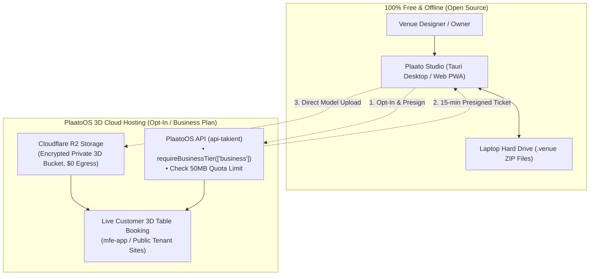

# OpenVenue3D (Plaato Studio)

> **Open-Source 3D Spatial Floorplanner & Object Constructor for Venues**  
> Build, customize, and visualize commercial venues, furniture, and seating maps 100% offline on your laptop or publish directly to PlaatoOS.

---

## 🏗️ Architecture & Storage Model



---

## 💰 Pricing & Storage Model

| Tier | Price | Included Storage | What You Can Do |
|---|---|---|---|
| **Plaato Studio (Offline Open Source)** | **$0 (Free Forever)** | **Unlimited Local Disk** | Design venue layouts, draw 2D walls, place tables with 3D gizmos, import `.glb` models, and save `.venue` files on your computer. |
| **PlaatoOS Cloud 3D (Standard Included)** | **Included in Business Plan** | **50 MB Cloud Storage** | Publish your 3D venue online so guests can view photorealistic VIP sofas, bars, and book tables online. |
| **Cloud Storage Expansion (Opt-In Addon)** | **$5 / month per 100 MB** *(or 500 Coins)* | **Up to 1 GB+** | For mega-venues, casinos, and hotels with dozens of high-poly 3D furniture models. Hard quota guard prevents accidental overages. |

---

## 🔒 How Opt-In Storage Works

1. **Free by Default**: Using Plaato Studio creates **$0 cost** for you and your server. Everything runs locally on the user's laptop.
2. **Opt-In Required**: To enable live 3D customer bookings on PlaatoOS, the venue manager opts in under `Venue Settings > 3D Cloud Hosting`.
3. **Business Plan Gated**: The API checks [`requireBusinessTier(['business'])`](https://github.com/takient/takient). Free accounts are prompted to upgrade.
4. **Hard Quota Limit**: The API blocks uploads once the 50 MB threshold is reached, protecting both the venue and the platform from unexpected fees.
5. **Zero Server RAM**: 3D files upload directly to Cloudflare R2 via single-use, 15-minute presigned tickets. Zero 3D binaries pass through server memory.

---

## 📦 Packages in this Monorepo

- **`@openvenue/core`**: 3D spatial math, coordinate transforms (cm to meters), and `.venue` ZIP packaging.
- **`@openvenue/engine`**: Three.js runtime, procedural geometry builder, PBR materials, and 10,000+ lines of furniture definitions.
- **`@openvenue/viewer`**: Ultra-lightweight (<50KB) embeddable 3D customer viewer for web and mobile.
- **`@openvenue/editor`**: Interactive 3D viewport with `TransformControls` gizmos (W/E/R), 2D Sims-style wall pen, and `.glb` drag-and-drop.
- **`apps/desktop`**: Standalone native desktop application built with **Tauri v2** (Rust + WebView).
- **`apps/web`**: Web studio application deployable as a PWA (`creator.plaatoos.com`).

---

## 🚀 Quick Start (Local Development)

```bash
# Clone the repository
git clone https://github.com/takient/openvenue.git
cd openvenue

# Install dependencies
yarn install

# Start the web studio
yarn dev

# Run the Tauri desktop app
yarn workspace @openvenue/desktop tauri dev
```

---

## 📄 License

MIT License — free for personal and commercial use.
