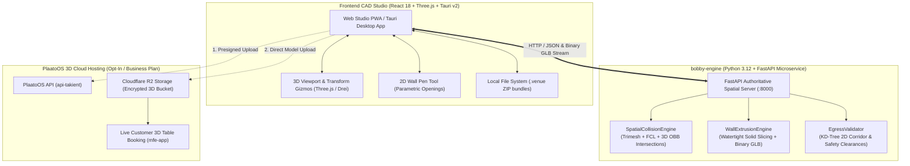

# Bobby 🛠️

> **"Can we build it? Yes we can!"**  
> **Hybrid 3D Spatial CAD Venue Builder & Object Constructor**  
> **React 18 / Three.js Frontend Monorepo + Standalone Python 3.12 Authoritative Geometry Microservice**  
> Design, validate, and visualize commercial venues, furniture, and seating maps 100% offline or publish directly to PlaatoOS.

[](https://github.com/luisenriquecgongora/bobby/releases)
[](https://github.com/luisenriquecgongora/bobby)
[](https://github.com/luisenriquecgongora/bobby)
[](FUTURE_PLAN.md)
[](https://opensource.org/licenses/MIT)

> 🎓 **Master of AI Capstone Strategic Plan**: Read the complete 10-proposal mathematical and algorithmic AI roadmap in [**FUTURE_PLAN.md**](FUTURE_PLAN.md).

---

## 🏗️ Architecture & Dual-Engine System

Bobby pairs an interactive, high-framerate **TypeScript / Three.js** client with an authoritative **Python 3.12** computational geometry backend microservice:



---

## 📦 Packages & Services in this Monorepo

### Microservices (`services/`)
- **`services/bobby-engine`**: Standalone, containerized **Python 3.12 / FastAPI** backend responsible for authoritative 3D mesh collision detection (Trimesh / FCL / OBB), algorithmic watertight wall extrusion with door/window aperture slicing (Shapely), and 2D emergency egress corridor safety validation (SciPy KD-Tree). Runs on free tiers with <100MB RAM.

### Core & Frontend Libraries (`packages/`)
- **`@bobby/core`**: Authoritative 3D spatial math, metric coordinate transforms (cm to meters), spatial engine client & serialization, `.venue` ZIP packaging, and version history.
- **`@bobby/engine`**: Client Three.js runtime, procedural geometry builder, PBR materials, and procedural furniture definitions.
- **`@bobby/viewer`**: Ultra-lightweight (<50KB) embeddable 3D customer viewer for web and mobile.
- **`@bobby/editor`**: Interactive 3D viewport with `TransformControls` gizmos (W/E/R), 2D Sims-style wall pen, real-time collision visualizer, spatial validation drawer, and GLB drag-and-drop.
- **`@bobby/connector-plaato`**: Cloud sync adapter connecting Bobby to PlaatoOS / Takient platform with direct Cloudflare R2 presigned uploads.

### Applications (`apps/`)
- **`apps/desktop`**: Standalone native desktop application built with **Tauri v2** (Rust + WebView).
- **`apps/web`**: Web studio application deployable as a PWA (`creator.plaatoos.com`).

---

## 💰 Pricing & Storage Model

| Tier | Price | Included Storage | What You Can Do |
|---|---|---|---|
| **Bobby Studio (Offline Open Source)** | **$0 (Free Forever)** | **Unlimited Local Disk** | Design venue layouts, draw 2D walls, place tables with 3D gizmos, validate collisions with `bobby-engine`, import `.glb` models, and save `.venue` files on your computer. |
| **PlaatoOS Cloud 3D (Standard Included)** | **Included in Business Plan** | **50 MB Cloud Storage** | Publish your 3D venue online so guests can view photorealistic VIP sofas, bars, and book tables online. |
| **Cloud Storage Expansion (Opt-In Addon)** | **$5 / month per 100 MB** *(or 500 Coins)* | **Up to 1 GB+** | For mega-venues, casinos, and hotels with dozens of high-poly 3D furniture models. Hard quota guard prevents accidental overages. |

---

## 🚀 Quick Start (Local Development)

### 1. Prerequisites
- **Node.js** >= 18 and **Yarn** 1.22
- **Python** 3.12 (or 3.11) with `pip`
- *(Optional)* **Docker** for containerized engine execution

### 2. Install & Start Frontend
```bash
# Clone the repository
git clone https://github.com/luisenriquecgongora/bobby.git
cd bobby

# Install monorepo dependencies
yarn install

# Run automated TypeScript test suites (Vitest - 21 tests)
yarn test

# Start the web studio (:5173)
yarn dev
```

### 3. Start Python Computational Geometry Engine
```bash
# Option A: Local Python venv
cd services/bobby-engine
python -m venv .venv
# On Windows: .venv\Scripts\activate | On macOS/Linux: source .venv/bin/activate
pip install -r requirements.txt

# Run Python geometry test suites (Pytest - 18 tests)
pytest

# Launch FastAPI microservice on http://localhost:8000
uvicorn src.main:app --host 0.0.0.0 --port 8000 --reload

# Option B: Docker container (<100MB RAM)
docker compose up --build
```

Interactive OpenAPI documentation for `bobby-engine` is available at `http://localhost:8000/docs`.

---

## 📄 License

MIT License — free for personal and commercial use.
