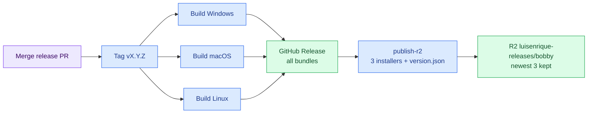

# Bobby (Openvenue) Release & Distribution Architecture 🚀

> **Authoritative guide for packaging, signing, and releasing Bobby CAD desktop applications and spatial engine binaries via Cloudflare R2 and GitHub Releases.**  
> *Follows the same release layout as `yapper` and `emiliano`, in the personal `luisenrique-releases` bucket.*

---

## 🌐 Unified Distribution Model

Bobby releases live in Luis Enrique's personal Cloudflare account. Every release is attached to its GitHub Release, and the main installer for each platform (Windows setup `.exe`, macOS `.dmg`, Linux `.AppImage`) is mirrored to the shared Cloudflare R2 downloads bucket with zero egress fees and worldwide edge caching.

### Cloudflare R2 Credentials & Endpoints

| Parameter | Production Value | Description |
| :--- | :--- | :--- |
| **Cloudflare Account ID** | `R2_ACCOUNT_ID` repository secret | Luis Enrique's personal Cloudflare account |
| **Download Bucket** | `luisenrique-releases` | Public release bucket shared by bobby, emiliano, yapper and the other research projects (10 GB free tier; keep at most 3 versions per project) |
| **Public Edge Host** | `https://pub-fb9de4da4f48439ebb34b3795d05ab11.r2.dev` | Global edge distribution URL |
| **Custom Domain** *(Optional)* | None yet | Add one later with an R2 Custom Domain; the r2.dev URL is rate-limited |

---

## 📁 Object Storage Hierarchy

R2 holds **one main installer per platform**, so the shared bucket stays inside the 10 GB free tier. The other formats Tauri builds (`.msi`, `.deb`, `.rpm`, `.app.tar.gz`) are only on the GitHub Release.

```text
luisenrique-releases/
└── bobby/
    ├── latest/                                  # always the newest release (5 min cache)
    │   ├── Bobby-windows-x64-setup.exe
    │   ├── Bobby-macos-universal.dmg
    │   ├── Bobby-linux-x64.AppImage
    │   └── version.json                         # no-cache
    │
    └── v0.2.0/                                  # one folder per release, newest 3 kept
        ├── Bobby-v0.2.0-windows-x64-setup.exe   # immutable (1-year cache)
        ├── Bobby-v0.2.0-macos-universal.dmg
        ├── Bobby-v0.2.0-linux-x64.AppImage
        └── version.json                         # version, date, SHA-256 and URLs per platform
```

### Cache Headers Policy
- **Versioned files (`/vX.Y.Z/*`)**: `public, max-age=31536000, immutable` (content never changes).
- **Latest installers (`/latest/*`)**: `public, max-age=300` (5-minute edge cache).
- **Latest manifest (`/latest/version.json`)**: `no-cache, must-revalidate`.

### Retention
`scripts/prune_r2_releases.py` keeps the newest **3** versioned folders and deletes older ones on every publish. The cap cannot be raised or switched off, and a failed prune fails the release. `latest/` is never deleted. Older versions stay downloadable from GitHub Releases.

---

## 🔄 In-Browser vs Desktop Proxying (CORS)

Like `robot_host`, Bobby uses a hybrid network model:

1. **Direct Binary Downloads (`.msi` / `.exe` / `.dmg`)**:
   - Web browsers downloading the setup file (`<a href="..." download>`) do **not** trigger CORS checks.
   - Downloads stream directly from `https://pub-fb9de4da4f48439ebb34b3795d05ab11.r2.dev/bobby/latest/...` at wire speed.

2. **Tauri Desktop Auto-Updater**:
   - The desktop client runs natively and polls `https://pub-fb9de4da4f48439ebb34b3795d05ab11.r2.dev/bobby/latest/latest.json`.
   - Native network clients are not subject to browser cross-origin security boundaries.

3. **In-Browser Admin / Tenant Manifest Reads**:
   - If an admin panel on a custom tenant domain (`app.<tenant>.com`) fetches `latest.json` via JavaScript `fetch()`, Cloudflare R2's `r2.dev` CORS policy will reject the cross-origin preflight.
   - For web apps, route through the API proxy (e.g. `GET /public/bobby/latest-release` in `api-takient` or Next.js edge route) matching `GetLatestRobotHostRelease.ts`.

---

## 🛠️ Tauri v2 Auto-Updater Configuration (planned, not set up yet)

> The updater plugin is not configured and no `latest.json` is published yet. The steps below are the plan for when it is added: it needs a signing key pair, and the publish step would also have to upload the signed `.app.tar.gz` / `.msi.zip` bundles and `latest.json`.

In `apps/desktop/src-tauri/tauri.conf.json`, configure the updater plugin to poll the R2 manifest:

```json
{
  "plugins": {
    "updater": {
      "active": true,
      "endpoints": [
        "https://pub-fb9de4da4f48439ebb34b3795d05ab11.r2.dev/bobby/latest/latest.json"
      ],
      "dialog": true,
      "pubkey": "YOUR_TAURI_UPDATE_PUBLIC_KEY"
    }
  }
}
```

The updater manifest `latest.json` format:
```json
{
  "version": "0.1.0",
  "notes": "Parametric aperture CSG cutting and 3D spatial collision validation.",
  "pub_date": "2026-10-28T12:00:00Z",
  "platforms": {
    "windows-x86_64": {
      "signature": "...",
      "url": "https://pub-fb9de4da4f48439ebb34b3795d05ab11.r2.dev/bobby/v0.1.0/Bobby-v0.1.0-windows-x64.msi.zip"
    },
    "darwin-universal": {
      "signature": "...",
      "url": "https://pub-fb9de4da4f48439ebb34b3795d05ab11.r2.dev/bobby/v0.1.0/Bobby-v0.1.0-darwin.app.tar.gz"
    }
  }
}
```

---

## 🤖 GitHub Actions Workflow Automation

Every push to `master` updates the "chore: release vX.Y.Z" PR (`release-please.yml`). Merging it creates the tag and starts `release.yml`:

1. **`release`** (Windows, macOS universal, Linux): `tauri-action` builds the desktop app and attaches every bundle to the GitHub Release for the tag.
2. **`publish-r2`** (after all three succeed): downloads the setup `.exe`, `.dmg` and `.AppImage` from that release, writes `version.json` (`scripts/publish_release_to_r2.py`), uploads to `bobby/vX.Y.Z/` and `bobby/latest/`, then enforces the 3-release cap.


Legend: purple = what you do, blue = workflow steps, green = where the files end up.

The publish step reads the repository secrets `R2_ACCOUNT_ID`, `R2_ACCESS_KEY_ID`, `R2_SECRET_ACCESS_KEY`, `R2_BUCKET_NAME` and `R2_CUSTOM_DOMAIN`. Its scripts are tested by `python scripts/verify.py --only python`.

---

## 📜 Manual Verification

Verify uploaded artifacts via terminal:
```bash
# Check the manifest (version, SHA-256 and URLs)
curl -s https://pub-fb9de4da4f48439ebb34b3795d05ab11.r2.dev/bobby/latest/version.json

# Test download headers (should return 200 OK with content-length)
curl -I https://pub-fb9de4da4f48439ebb34b3795d05ab11.r2.dev/bobby/latest/Bobby-windows-x64-setup.exe
```
