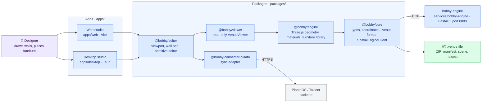
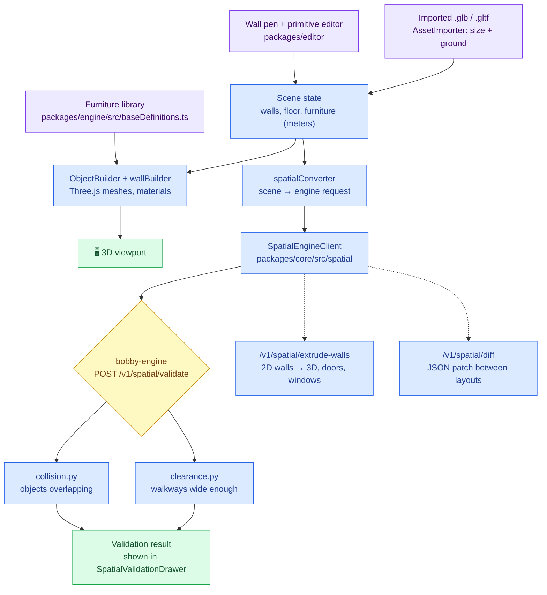
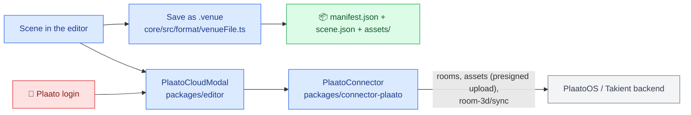

# Architecture

The map of Bobby: what its parts are, how a venue goes from a drawing to a validated 3D scene, and where to
change what. Keep it current: a change that adds, removes or rewires a part updates the diagram in the same
pull request (`AGENTS.md`, section 11).

## Color palette

| Color | Meaning |
| :--- | :--- |
| 🟦 Blue | Our code: packages, apps, services |
| 🟪 Purple | Inputs: the user's drawing, imported 3D models, furniture definitions |
| 🟨 Yellow | Checks and decisions |
| 🟩 Green | Outputs: 3D scene, `.venue` files, validation results |
| ⬜ Grey | External systems we do not own |
| 🟥 Red | Credentials (Plaato login) |

## The big picture

Bobby is a 3D venue designer: you draw walls and place furniture, and it renders the venue in 3D, checks it
for collisions and safe walkways, and syncs it to the Plaato platform.

**Dependency direction** (enforced by convention, see `AGENTS.md`): `core` ← `engine` ← `viewer` ← `editor` ←
apps. `editor` also uses `connector-plaato`. Packages never import from apps. Packages resolve each other
through their built `dist/`, so `typecheck` and `test` build first (`turbo.json`).

## From a drawing to a validated venue

Units are **meters** everywhere; dimensions are `[width, depth, height]`. Python uses `Vector3`, TypeScript
`Vector3D`. Only variant 0 of each furniture type renders (`getBaseDefinition`): see the
`add-furniture-definition` skill before adding one.

## Saving and syncing

The login token stays in the connector; never log it or write it into a `.venue` file.

## Parts

| Part | Folder | What it does | Talks to |
| :--- | :--- | :--- | :--- |
| Core | `packages/core` | Shared types, coordinate conversion, `.venue` format, `SpatialEngineClient` | bobby-engine |
| Engine (3D) | `packages/engine` | Three.js builders, materials, procedural textures; `baseDefinitions.ts` is the furniture library | Core |
| Viewer | `packages/viewer` | Read-only `VenueViewer` | Engine |
| Editor | `packages/editor` | Viewport, wall pen, primitive editor, validation drawer, asset importer, Plaato modal | Viewer, connector |
| Plaato connector | `packages/connector-plaato` | Login, rooms, asset upload, room sync | Plaato backend |
| Web / desktop studio | `apps/web`, `apps/desktop` | The two shells that compose the packages | Editor |
| bobby-engine | `services/bobby-engine` | FastAPI: `GET /health`, `POST /v1/spatial/validate`, `/extrude-walls`, `/diff`; geometry in `src/geometry/` | — |

## Where to change what

| To change... | Look in | Skill |
| :--- | :--- | :--- |
| Add a piece of furniture | `packages/engine/src/baseDefinitions.ts` | `.agents/skills/add-furniture-definition` |
| Add or change a geometry endpoint | `services/bobby-engine/src/api/routes.py`, then `spatialClient` / `spatialTypes` / `spatialConverter` | `.agents/skills/add-geometry-endpoint` |
| Validation rules (collisions, clearances) | `services/bobby-engine/src/geometry/` | `.agents/skills/add-geometry-endpoint` |
| The `.venue` file format | `packages/core/src/format/venueFile.ts` | `.agents/skills/review-change` |
| Plaato sync | `packages/connector-plaato/src/index.ts` | `.agents/skills/review-change` |
