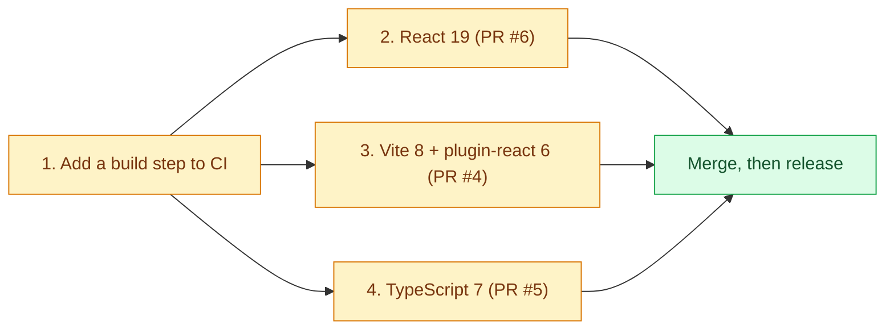

# Pending dependency upgrades

Dependabot opened these upgrades and they are **not merged yet**, because each one needs code changes first. Two of them look green in CI only because CI typechecks and tests but never builds or runs the apps (see "CI gap" below).

Legend: amber = work to do, green = the result.

## CI gap: the apps are never built in CI

`scripts/verify.py` (what CI runs) does `turbo run typecheck test`, not `build`. A dependency that breaks the bundle or the runtime still shows green. Add a `turbo run build` check (web app and packages; the Tauri desktop build is covered by the release workflow) so the upgrades below are tested.

## React 18 → 19 (Dependabot PR #6)

The PR moves `react-dom` and `@types/react-dom` to 19 but leaves `react` at 18. React DOM 19 needs React 19, so the apps would crash at startup. Upgrade as one change:

1. `react`, `react-dom`, `@types/react` and `@types/react-dom` to 19 in `apps/web`, `apps/desktop`, `packages/editor` and `packages/viewer` (the packages' peer ranges `>=18.0.0` already allow 19).
2. `@react-three/fiber` 8 supports only React 18: move to `@react-three/fiber@^9` and `@react-three/drei@^10` (the versions made for React 19) and follow fiber's v9 migration notes.
3. Build, then open the editor and viewer to check the 3D scenes.

## Vite 5 → 8 with @vitejs/plugin-react 6 (Dependabot PR #4)

`@vitejs/plugin-react` 6 requires Vite 8 (`peerDependencies: vite ^8`); `apps/web` and `apps/desktop` use Vite 5. Upgrade both together: `vite@^8` and `@vitejs/plugin-react@^6` in both apps, and move CI and the release workflow to Node 22 (Vite 8 needs Node 20.19+ or 22.12+). Then build both apps and run `tauri dev`.

## TypeScript 5 → 7 (Dependabot PR #5)

TypeScript 7 is the new native (Go) compiler. It no longer ships the JavaScript API that tsup uses to write `.d.ts` files, so building `packages/core` fails with `Cannot read properties of undefined (reading 'useCaseSensitiveFileNames')`. Either wait for a tsup release that supports TypeScript 7, or let tsup write only JavaScript (`dts: false`) and emit declarations with `tsc --emitDeclarationOnly`. Also remove the `tsconfig.json` options TypeScript 7 dropped (`moduleResolution: node`/`node10`, `esModuleInterop: false`, `baseUrl`) and list global types explicitly (`"types": [...]`).
