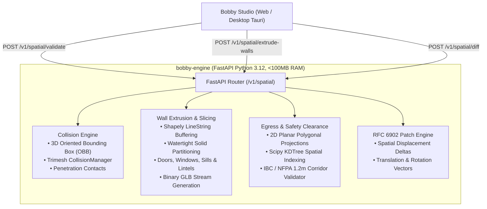

# Bobby Engine 📐⚡

> **High-Performance 3D Computational Geometry, Spatial Validation, and Algorithmic Wall Extrusion Microservice**  
> Standalone FastAPI backend for the Bobby CAD Venue Builder platform.

---

## 🏗️ Architecture & Purpose

While the client browser and Tauri desktop app manage UI state and Three.js rendering, `bobby-engine` acts as the **authoritative spatial validation engine**. It enforces architectural clearance codes, performs 3D collision detection, generates manifold 3D wall meshes with boolean aperture cutouts, and calculates RFC 6902 JSON patch diffs.



---

## 📐 Computational Geometry Capabilities

### 1. 3D Collision & Interference (`src/geometry/collision.py`)
- Constructs exact 3D Oriented Bounding Boxes (OBB) positioned at $(X, Y, Z)$ and rotated around the vertical axis by $\theta_y$.
- Employs a dual-tier collision architecture:
  - **Tier 1 (FCL)**: `trimesh.collision.CollisionManager` for accelerated C++ flexible collision checking.
  - **Tier 2 (Geometric SAT)**: Pure computational geometry evaluating 2D oriented polygon intersection combined with 1D vertical height interval overlap $[Y_{min}, Y_{max}]$.
- Distinguishes between `FIXTURE_FIXTURE` and `FIXTURE_WALL` collisions, accurately ignoring vertical elevations (e.g. overhead TVs and ceiling chandeliers above low coffee tables).

### 2. Algorithmic Wall Extrusion & Aperture Cutter (`src/geometry/extrusion.py`)
- Converts 2D wall centerline vectors into 3D architectural geometry:
  - Computes unit tangent $\hat{u}$ and perpendicular normal $\hat{n}$.
  - Buffers half-thickness using Shapely flat-capped 2D geometry.
  - Uses **Constructive Solid Partitioning**: longitudinally splits walls at door and window boundaries, generating watertight bottom sills ($Y < \text{sill}$), opening voids, and structural top lintels ($Y > \text{opening\_top}$).
- Zero triangular degeneracy or non-manifold edge artifacts.
- Compiles into standard **glTF 2.0 Binary (`.glb`)** byte streams ready for direct consumption by Three.js `GLTFLoader`.

### 3. Egress & Safety Clearance Validator (`src/geometry/clearance.py`)
- Enforces commercial egress corridors (default: 1.20m / 48in).
- Computes exact boundary-to-boundary polygonal Euclidean distance: $\min_{p_a \in A, p_b \in B} \|p_a - p_b\|$.
- Accelerates neighborhood queries with `scipy.spatial.KDTree` ($O(N \log N)$).
- Outputs human-readable aisle warnings with measured distances and calculated thresholds.

### 4. RFC 6902 JSON Patch & Spatial Delta Engine (`src/api/routes.py`)
- Generates RFC 6902 patch operations (`add`, `remove`, `replace`) between previous and current layout revisions.
- Computes exact spatial translation vectors ($\Delta x, \Delta y, \Delta z$, Euclidean distance moved) and angular rotation deltas ($\Delta \theta$).

---

## 🚀 Quick Start (Local Python)

```bash
# Navigate to the service
cd services/bobby-engine

# Create virtual environment
python -m venv .venv
source .venv/bin/activate  # On Windows: .venv\Scripts\activate

# Install dependencies
pip install -r requirements.txt

# Run the test suite (18 unit & integration tests)
pytest tests -v

# Start development server
python -m uvicorn src.main:app --reload --port 8000
```

The interactive OpenAPI documentation is available at:  
👉 **`http://localhost:8000/docs`**

---

## 🐳 Docker Deployment (<100MB RAM)

The service is multi-stage containerized on `python:3.12-slim` and runs as an unprivileged non-root user `bobby`:

```bash
# Build and run with Docker Compose
docker compose up --build -d

# Check health
curl http://localhost:8000/health
```

---

## 📡 REST API Endpoints

### 1. `GET /health`
Liveness and uptime check.
```json
{
  "status": "ok",
  "service": "bobby-engine",
  "version": "0.1.0",
  "uptime_seconds": 12.4
}
```

### 2. `POST /v1/spatial/validate`
Validates 3D collisions and corridor egress clearances.
- **Query param**: `min_clearance` (optional, default `1.20`).
- **Input**: `VenueLayout` JSON.
- **Output**: `ValidationResult`.

### 3. `POST /v1/spatial/extrude-walls`
Extrudes walls with door/window cutouts into a compiled 3D mesh.
- **Query param**: `format=glb` (default) or `format=json`.
- **Output**: Binary GLB file (`model/gltf-binary`) or JSON mesh summary.

### 4. `POST /v1/spatial/diff`
Computes RFC 6902 patches and 3D displacement vectors between layout states.
- **Input**: `{"previous": VenueLayout, "current": VenueLayout}`.
- **Output**: `LayoutDiffResponse`.
